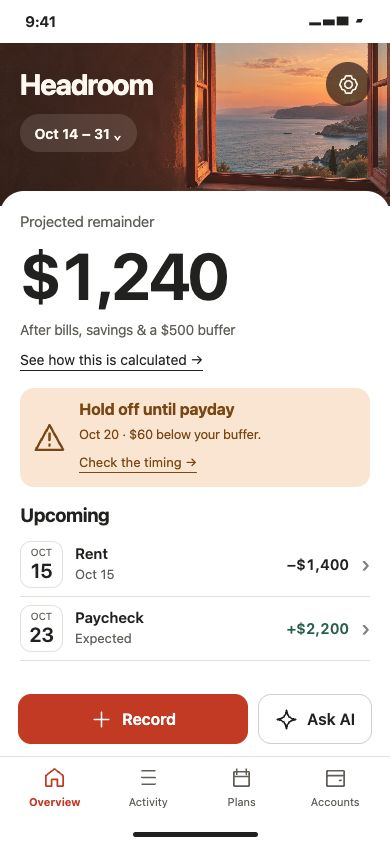
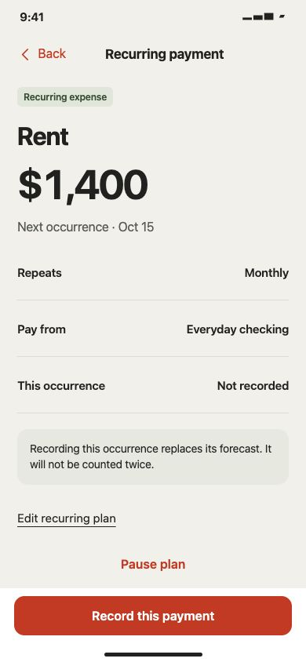
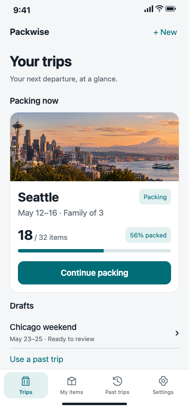
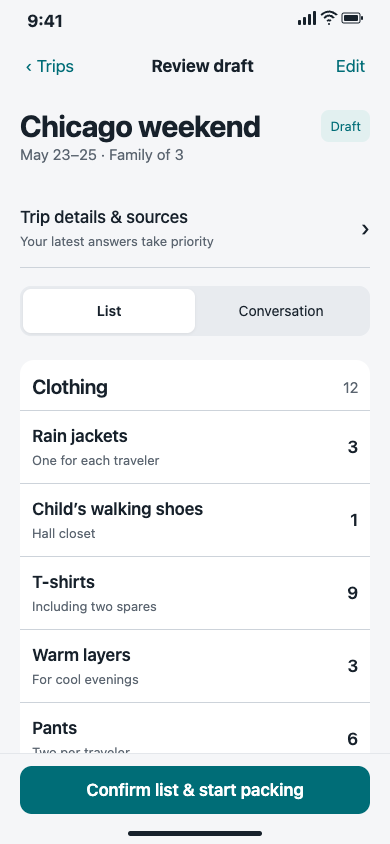
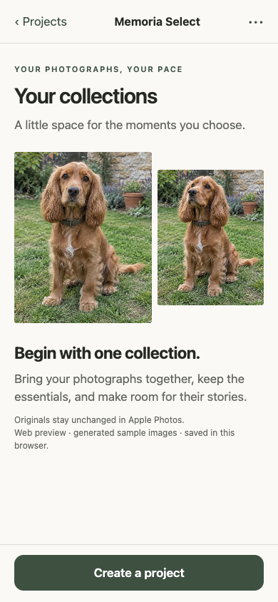
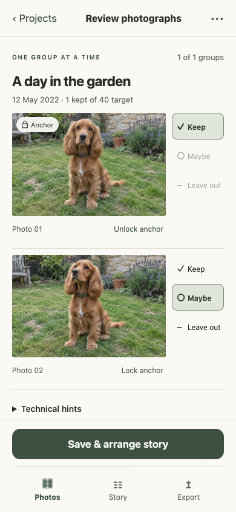

# iPhone UI

给 Codex 使用的 iPhone App 设计技能。从产品描述出发，逐步完成页面布局、低保真、视觉方案、AI 整屏效果图和可交互手机原型，并整理供 SwiftUI 开发使用的交接包。

当前版本：**0.5.1**。默认面向美国市场，界面使用美式英语，设计说明使用对话语言；可以按用户要求调整。

## 页面案例

以下是本工作区已有设计项目的 **HTML 可交互原型实拍截图**，用于展示页面布局和视觉效果，并非原生 iOS App 截图，也不是本轮新生成的概念图。展示的是各项目已保存的具体版本；示例数据与图片不代表真实账户、行程或用户照片。点击图片可以查看原尺寸。

### Headroom · 预算与现金流

以预计可用余额为首页视觉中心，结合账单时间提醒和记账入口；周期支出页集中呈现金额、扣款账户和本次记录状态。首页采用 round-06 截图，周期支出页采用基准截图。

| 预算概览 | 周期支出 |
| --- | --- |
| <a href="assets/examples/headroom-overview.png"></a> | <a href="assets/examples/headroom-recurring-payment.png"></a> |

### Packwise · 旅行打包清单

采用「A 行程映像」v2 交付包：行程封面与打包进度帮助用户继续当前旅行，草稿审阅页展示分类、物品数量与理由，并保留明确的清单确认动作。

| 行程首页 | 清单草稿审阅 |
| --- | --- |
| <a href="assets/examples/packwise-home.png"></a> | <a href="assets/examples/packwise-review.png"></a> |

### Memoria Select · 照片筛选与故事整理

采用六页 MVP 的首页与复核页：以照片为主体，用 Keep、Maybe、Leave out 表达筛选状态，再进入故事整理。此项目界面采用英式英语，宠物照片为生成示例。

| 照片集合入口 | 照片复核 |
| --- | --- |
| <a href="assets/examples/memoria-home.png"></a> | <a href="assets/examples/memoria-review.png"></a> |

这里展示视觉与交互设计成果，不代表银行、AI、系统照片库或支付等正式服务已接入。截图原样收录，来源版本与 SHA-256 记录见 [案例清单](assets/examples/manifest.json)。

## 工作流程

1. 理解产品，列出主要页面和每页任务。
2. 规划页面上、中、下内容、信息层级、图片位置和首屏密度。
3. 制作覆盖全部主要页面的灰阶低保真，等待布局确认。
4. 提供配色、字体、图片与控件的视觉方案，等待选择。
5. 使用 Image Gen，按已确认布局逐页生成整屏效果图，迭代并确认整套设计。
6. 从确认图提炼设计规范，开发 HTML/CSS/JS 可交互 Demo。
7. 对照效果图检查视觉和流程，整理开发交接包。

默认有三个确认点：低保真布局、视觉方案、高保真效果图。用户可以明确调整流程。已确认阶段和选择记录在项目的 `design/decisions.md`，避免重复确认。

## 安装

需要 Git 和可使用本地技能的 Codex。完整克隆仓库，以保留脚本、模板和参考文件：

```bash
mkdir -p "${CODEX_HOME:-$HOME/.codex}/skills"
git clone https://github.com/1085995907ljh-hash/iphone-ui.git \
  "${CODEX_HOME:-$HOME/.codex}/skills/iphone-ui"
```

私有仓库需要先取得访问权限并完成 GitHub 身份验证。若目标目录已经存在，先检查并备份已有修改，不要直接覆盖或删除。安装后确认 `SKILL.md`、`agents`、`references`、`scripts` 和 `assets` 均存在；在新对话中调用技能。

## 使用示例

在产品项目目录中向 Codex 发送：

```text
使用 $iphone-ui，为我的 iPhone App 设计原型。
产品描述：[填写目标用户、核心任务和已有需求，或提供文档路径]
先梳理主要页面，制作完整低保真供我确认，再选择视觉方案、生成整屏效果图。
效果图确认后开发可交互 Demo，并交付 SwiftUI 开发所需的设计与状态规格。
```

已有设计时，提供文件路径和已确认的版本。技能会沿用确认记录，局部修正不需要重走全部流程。

## 交付内容

- 可打开的 HTML 手机原型及独立素材。
- `design.md` 设计规范、设计变量、页面与状态规格。
- 已确认的整屏效果图及版本记录。
- 基准视口的截图与验证证据。
- SwiftUI 交接说明与 ZIP 包。

具体内容取决于已完成的阶段。默认交付浏览器原型，不自动创建 Xcode 工程，不承诺 HTML 自动转换为原生代码。不同 iPhone 尺寸、大字和原生键盘等适配要求写入交接文档，交由原生实现验证。

## 环境与工具

| 用途 | 条件 |
| --- | --- |
| 设计与文件生成 | 能读取和写入项目文件的 Codex |
| 整屏效果图 | 可用的 Image Gen 工具及对应 imagegen 技能 |
| 方案对比页 | Python 3.10+；仓库内附生成器与 HTML 模板 |
| 浏览器截图 | Node.js 22+ 与本机 Chrome、Chromium 或 Edge |

安装本技能不会自动安装上述工具。生成器和截图脚本用法见 [工具说明](references/tools.md)。Image Gen 不可用时应说明缺口，不用网页截图冒充生成效果图。

Apple 设计约束贯穿流程。已安装的 `ios-ui-ux-reviewer` 可提供规则参考，仓库也包含后备规则快照；版本敏感规则需要核对 Apple 当前官方文档。浏览器验证不等于真实 iOS 设备验证。

## 文件说明

- [SKILL.md](SKILL.md)：技能入口和阶段约束。
- [布局与高保真](references/layout-and-hifi.md)：布局、视觉选择和整屏生成要求。
- [图片规划](references/imagery.md)：图片用途与素材约束。
- [iPhone 交互规则](references/iphone-patterns.md)：交互与状态设计。
- [验收说明](references/review.md)：视觉与流程检查。
- [SwiftUI 交接](references/swiftui-handoff.md)：交付包和原生适配要求。
- [来源记录](UPSTREAM.md)：上游来源与修改范围。

## 来源与许可

基于 `oil-oil/oil-ui` 0.18.1 的部分开源工具改编，非 Oil UI 官方版本。保留 MIT [LICENSE](LICENSE) 和来源记录，不自动同步上游。iPhone 专用流程及参考文件的改编范围见 [UPSTREAM.md](UPSTREAM.md)。
