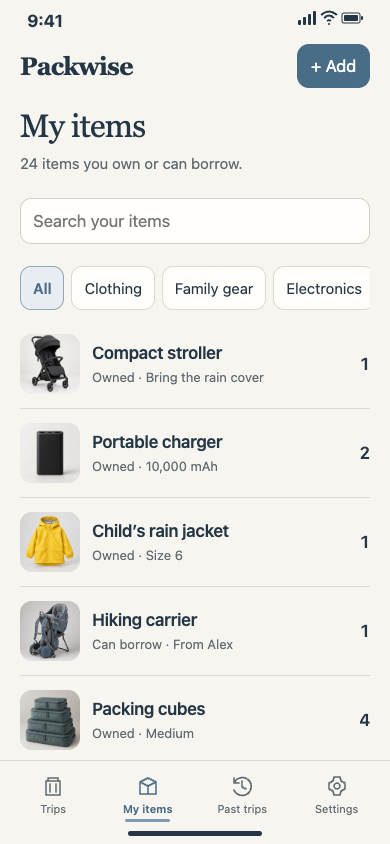
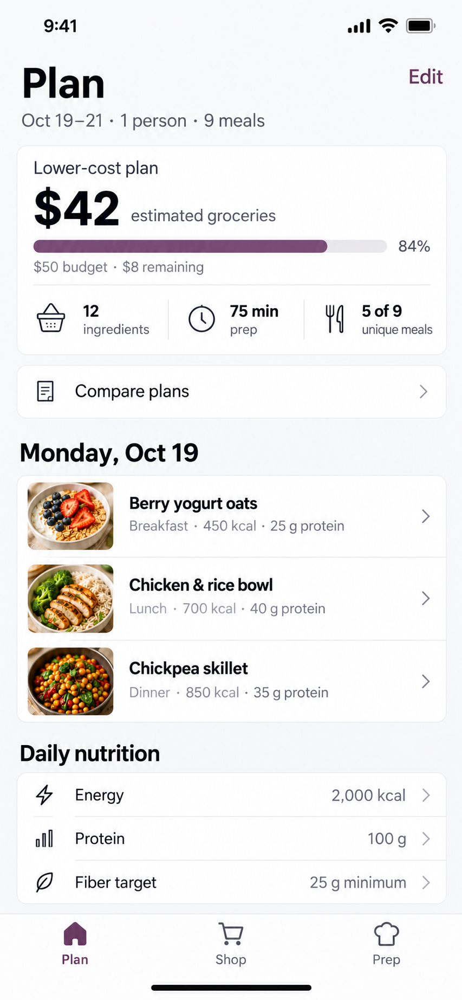
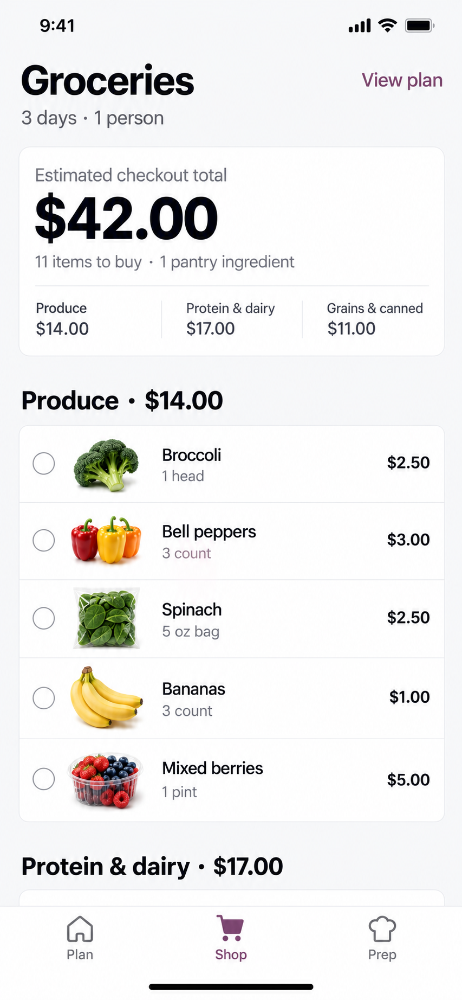

# iPhone UI

面向 Codex、Claude Code、WorkBuddy 等支持 Agent Skills 的软件的 iPhone App 设计技能。从产品描述出发，逐步完成页面布局、低保真、视觉方案、AI 整屏效果图和可交互手机原型，并整理供 SwiftUI 开发使用的交接包。各宿主的安装入口和可用工具不同，完整流程需要参考图生图、浏览器操作与看图能力。

当前版本：**0.6.0**。默认面向美国市场，界面使用美式英语，设计说明使用对话语言；可以按用户要求调整。

Codex 快速安装：`npx skills add 1085995907ljh-hash/iphone-ui --skill iphone-ui -g -a codex`。其他软件按下方命令选择目标。WorkBuddy 用户可直接下载 [0.6.0 ZIP 安装包](https://github.com/1085995907ljh-hash/iphone-ui/releases/download/v0.6.0/iphone-ui-0.6.0-workbuddy.zip)，按下方说明导入。安装入口适配不代表已在各软件中完成全流程实测，见 [验证记录](docs/compatibility-validation.md)。

## 页面案例

以下为用户提供的 Packwise 与 NourishSet 页面图片，原样收录。点击图片可查看原尺寸。

### Packwise · 旅行打包清单

行程首页展示目的地封面、打包进度与继续打包入口；物品页支持搜索、分类查看，以及管理已有或可借用的旅行用品。

| 行程首页 | 我的物品 |
| --- | --- |
| <a href="assets/examples/packwise-home.png"></a> | <a href="assets/examples/packwise-items.png"></a> |

### NourishSet · 饮食规划

计划页集中展示购物预算、备餐时间、每日餐单与营养目标；购物页按食材类别展示待购物品、数量和预估价格。

| 饮食计划 | 购物清单 |
| --- | --- |
| <a href="assets/examples/nourishset-plan.png"></a> | <a href="assets/examples/nourishset-shop.png"></a> |

案例用于展示界面设计，示例金额、行程和食材不代表真实用户数据，也不表示正式服务已接入。文件来源与 SHA-256 记录见 [案例清单](assets/examples/manifest.json)。

## 工作流程

1. 理解产品，列出主要页面和每页任务。
2. 规划页面上、中、下内容、信息层级、图片位置和首屏密度。
3. 制作覆盖全部主要页面的灰阶低保真，等待布局确认。
4. 提供配色、字体、图片与控件的视觉方案，等待选择。
5. 使用 Image Gen，按已确认布局逐页生成整屏效果图，迭代并确认整套设计。
6. 从确认图提炼设计规范，开发 HTML/CSS/JS 可交互 Demo。
7. 对照效果图检查视觉和流程，整理开发交接包。

默认有三个确认点：低保真布局、视觉方案、高保真效果图。用户可以明确调整流程。已确认阶段和选择记录在项目的 `design/decisions.md`，避免重复确认。

## 安装

### 通用命令：Codex、Claude Code、Cursor 等

需要 Node.js、npm、Git 和可访问 GitHub 的环境。使用 [Skills CLI](https://github.com/vercel-labs/skills) 明确指定目标 Agent；`-g` 表示用户级安装，省略则安装到当前项目。CLI 负责按宿主选择目录，不必手动维护多份路径。

```bash
# Codex
npx skills add 1085995907ljh-hash/iphone-ui --skill iphone-ui -g -a codex

# Claude Code
npx skills add 1085995907ljh-hash/iphone-ui --skill iphone-ui -g -a claude-code

# 只安装到指定软件，可单独选择其中一个
npx skills add 1085995907ljh-hash/iphone-ui --skill iphone-ui -g -a codex -a claude-code
```

需要非交互安装时，在命令末尾添加 `-y`；首次运行 npx 也可能询问是否下载 Skills CLI。建议保留 `-a`：不指定时，CLI 可能根据交互环境或 Agent 检测自动选择多个目标，其中部分目标不支持全局安装，产生与 iphone-ui 无关的警告。

Cursor、Gemini CLI、CodeBuddy 等以 CLI 当前支持列表为准。CodeBuddy 和 WorkBuddy 是不同安装目标，不用 `-a codebuddy` 代替 WorkBuddy 导入。

安装后开启新会话，确认可发现 `iphone-ui`，并能读取 `references/agent-compatibility.md` 和 `assets/style-explorer.html`。旧版本若通过 Git 克隆安装，先检查旧目录，选择保留原方式或备份后迁移，避免两份同名技能同时加载。

### WorkBuddy：上传 ZIP

1. 下载 [iphone-ui-0.6.0-workbuddy.zip](https://github.com/1085995907ljh-hash/iphone-ui/releases/download/v0.6.0/iphone-ui-0.6.0-workbuddy.zip)，其他版本见 [Releases](https://github.com/1085995907ljh-hash/iphone-ui/releases)。如需核对下载完整性，可同时下载 [SHA256SUMS](https://github.com/1085995907ljh-hash/iphone-ui/releases/download/v0.6.0/SHA256SUMS)。
2. 打开 **专家·技能·连接器 → 技能 → 添加技能 → 上传技能**，选择 ZIP 导入。
3. 在已安装列表确认技能启用，开启新会话，要求使用 `iphone-ui` 并读取宿主适配说明。

入口依据 [WorkBuddy 官方文档](https://www.codebuddy.cn/docs/workbuddy/From-Beginner-to-Expert-Guide/Function-Description/Skills-Market)。当前 ZIP 尚需在实际 WorkBuddy 中验证导入与运行，不宣称已上架市场。Claude Code 的本地技能安装与 Claude 网页端上传也不属于同一个入口。

### 手动安装：完整目录

需要 Git 和支持本地 Skills 的 Agent。完整克隆仓库，以保留脚本、模板和参考文件。以下为原有 Codex 安装方式；自定义安装根目录或其他宿主请使用其实际扫描目录：

```bash
mkdir -p "${CODEX_HOME:-$HOME/.codex}/skills"
git clone https://github.com/1085995907ljh-hash/iphone-ui.git \
  "${CODEX_HOME:-$HOME/.codex}/skills/iphone-ui"
```

Claude Code 用户级目录为 `~/.claude/skills/iphone-ui`。其他宿主按官方约定放置整个 `iphone-ui` 目录，不只复制 `SKILL.md`。

本仓库公开，下载与克隆无需申请仓库权限。若目标目录已经存在，先检查并备份已有修改，不要直接覆盖或删除。安装后确认 `SKILL.md`、`agents`、`references`、`scripts` 和 `assets` 均存在；在新对话中调用技能。

### 更新、卸载与打包

通过 Skills CLI 安装的版本，使用其命令管理：

```bash
npx skills update iphone-ui -g
npx skills remove iphone-ui -g
```

手动 Git 安装先检查 `git status`，工作区干净时使用 `git pull --ff-only`。ZIP 安装下载新版本后在宿主管理界面更新；若不支持原位更新，先保留项目成果，再卸载旧技能并导入新版。不要混用不同安装方式更新同一份技能。

在完整仓库根目录打包（Python 3.10+，仅标准库）：

```bash
python3 scripts/package_skill.py
```

输出到 `dist/`：WorkBuddy 包的根目录直接包含 `SKILL.md`；另附包含 `iphone-ui/` 顶层目录的便携包，供需要目录形式的导入器使用，以及 `SHA256SUMS`。两份包来自同一源码，包含脚本、参考资料和素材，不包含 Git 元数据、环境文件或本地构建目录。脚本不会上传或发布，默认拒绝覆盖同版本文件。

## 使用示例

在产品项目目录中向 Agent 发送以下通用请求。Codex 可用 `$iphone-ui`，Claude Code 可用 `/iphone-ui`（插件安装时以其实际命名空间为准）；WorkBuddy 在技能列表启用后用名称调用。

```text
使用 iphone-ui 技能，为我的 iPhone App 设计原型。
产品描述：[填写目标用户、核心任务和已有需求，或提供文档路径]
先梳理主要页面，制作完整低保真供我确认，再选择视觉方案、生成整屏效果图。
效果图确认后开发可交互 Demo，并交付 SwiftUI 开发所需的设计与状态规格。
```

已有设计时，提供文件路径和已确认的版本。技能会沿用确认记录，局部修正不需要重走全部流程。

## 交付内容

- 可打开的 HTML 手机原型及独立素材。
- `design.md` 设计规范、设计变量、页面与状态规格。
- 已确认的整屏效果图及版本记录。
- 基准视口的截图与验证证据。
- SwiftUI 交接说明与 ZIP 包。

具体内容取决于已完成的阶段。默认交付浏览器原型，不自动创建 Xcode 工程，不承诺 HTML 自动转换为原生代码。不同 iPhone 尺寸、大字和原生键盘等适配要求写入交接文档，交由原生实现验证。

## 环境与工具

| 用途 | 条件 |
| --- | --- |
| 设计与文件生成 | 能加载完整 Skill 并读取和写入项目文件的 Agent |
| 整屏效果图 | 已配置、支持参考图输入并能保存结果的图像生成工具；有对应 Skill 时读取其说明 |
| 方案对比页 | Python 3.10+；仓库内附生成器与 HTML 模板 |
| 浏览器截图 | 宿主浏览器工具，或 Node.js 22+ 与本机 Chrome、Chromium 或 Edge |
| 视觉验收 | 能实际查看参考图与原型截图的模型或看图工具 |

安装本技能不会自动安装上述工具，也不会为其他 Agent 提供 Codex 的内置工具。生成器和截图脚本用法见 [工具说明](references/tools.md)，各阶段的能力要求见 [宿主适配](references/agent-compatibility.md)。生图不可用时可保留低保真、已选视觉方案和逐页提示词，停在效果图阶段；不用网页截图冒充生成效果图，也不默认跳过确认继续开发。

Apple 设计约束贯穿流程。已安装的 `ios-ui-ux-reviewer` 可提供规则参考，仓库也包含后备规则快照；版本敏感规则需要核对 Apple 当前官方文档。浏览器验证不等于真实 iOS 设备验证。

## 文件说明

- [SKILL.md](SKILL.md)：技能入口和阶段约束。
- [布局与高保真](references/layout-and-hifi.md)：布局、视觉选择和整屏生成要求。
- [图片规划](references/imagery.md)：图片用途与素材约束。
- [iPhone 交互规则](references/iphone-patterns.md)：交互与状态设计。
- [验收说明](references/review.md)：视觉与流程检查。
- [SwiftUI 交接](references/swiftui-handoff.md)：交付包和原生适配要求。
- [来源记录](UPSTREAM.md)：上游来源与修改范围。

## 来源与许可

基于 `oil-oil/oil-ui` 0.18.1 的部分开源工具改编，非 Oil UI 官方版本。保留 MIT [LICENSE](LICENSE) 和来源记录，不自动同步上游。iPhone 专用流程及参考文件的改编范围见 [UPSTREAM.md](UPSTREAM.md)。
